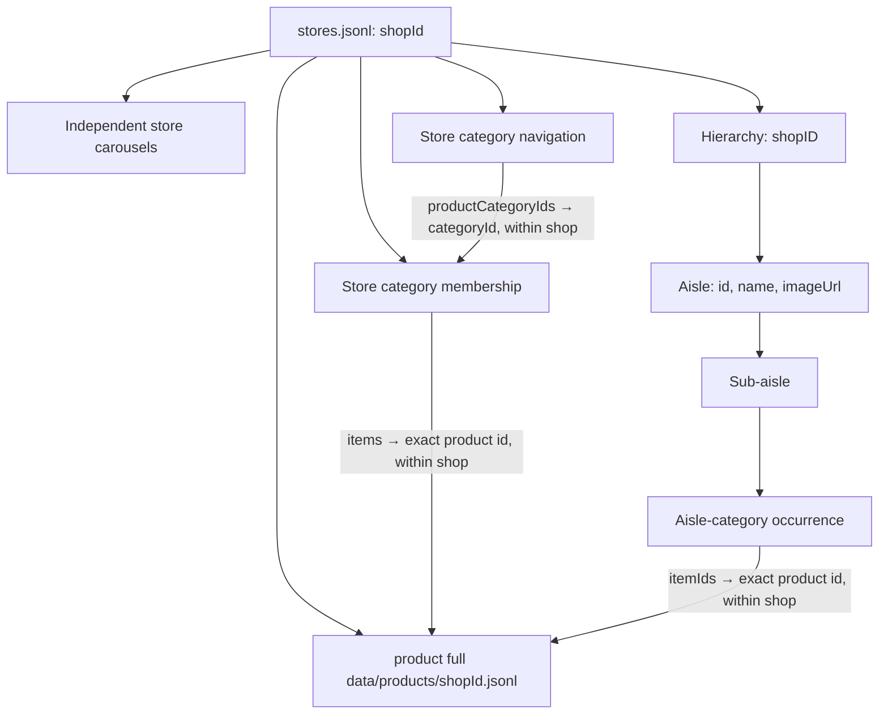

# Store dataset: file connections and agent usage guide

Updated: 2026-10-21. This guide describes the full datasets currently in this folder. It replaces the earlier guide based on isolated reference examples.

The active hierarchy is `store_aisles+subs+categories_products.jsonl`. Its update adds `aisles[].imageUrl`, which is a URL string or `null`. Comparing all 105 records with `store_aisles+subs+categories_products.jsonl.before-images.bak` confirmed that removing this field makes the records identical to the backup: shop IDs, aisle structure, category memberships, and product references have not changed.

## 1. Active files and actual locations

Paths below are relative to this guide's folder.

| Active source | Meaning | Current contents |
| --- | --- | --- |
| `stores.jsonl` | Shop identity and display metadata | 108 records; 108 shops |
| `store_carousels.jsonl` | Independent store carousel entries | 108 shops; 1,179 entries |
| `store_categories.jsonl` | Store category navigation | 108 shops; 3,572 navigation entries; 3,599 product-category ID references |
| `store_categories_products.jsonl` | Flat store-category product membership | 105 shops; 2,919 categories; 51,296 item-ID occurrences |
| `store_aisles+subs+categories_products.jsonl` | Aisle → sub-aisle → aisle-category product membership, including aisle images | 105 shops; 2,395 aisles; 19,585 sub-aisles; 44,012 category occurrences; 1,173,643 item-ID occurrences |
| `product full data/products/<shopId>.jsonl` | Product details for the shop identified by the filename | 108 files; 457,527 records; 452,269 distinct `(shop_id, product.id)` pairs |

Each nonblank JSONL line is one JSON object. Stream these files line by line. There is one record per shop in each non-product source in the current snapshot; check for duplicates again after future updates.

The product folder is **`product full data/products/`**, not the dataset root. For example, shop `1175` resolves products in `product full data/products/1175.jsonl`.

### Reference files and older snapshots

These files help explain shapes or history; do not ingest them alongside the active sources:

- `stores.ref.json`, `store_carousels.ref.json`, `store_categories.ref.json`, and `store_categories_products.ref.json` are individual examples, not complete source datasets. The current store reference contains only shop `1175`, slug `shoprite`, and retailer `205`; use `stores.jsonl` for the complete store metadata.
- `product full data/product.ref.json` is the product schema example. Its ID `items_17550-25320157` occurs in shop file `1175.jsonl`; ownership comes from the actual filename, not from interpreting the product ID prefix. Its name says “Cento Italian Sea Salt” while its Details section and slug describe Italian seasoning. Preserve the source values.
- `store_aisles+subs+categories_products.json` is the older single-shop hierarchy example for shop `4611`. It has no aisle `imageUrl` field and is not the current hierarchy source.
- `store_aisles+subs+categories_products.jsonl.before-images.bak` is the pre-image backup. Do not load it as a second hierarchy dataset.

The earlier references to `stores.ref(1).json` and to unavailable full datasets no longer describe this folder.

## 2. Connection map



Carousels, store categories, and the aisle hierarchy are separate store-associated entities. The owner confirmed that carousels have no relationship to aisles, and that store categories have no relationship to aisle categories. Shared names, slugs, category numbers, or product references do not establish a mapping between these systems.

| Relationship | Source | Target / lookup rule |
| --- | --- | --- |
| Store → carousels | `stores.shopId` | `store_carousels.shopId` |
| Store → category navigation | `stores.shopId` | `store_categories.shopId` |
| Store → flat category membership | `stores.shopId` | `store_categories_products.shopId` |
| Store → aisle hierarchy | `stores.shopId` | `store_aisles+subs+categories_products.shopID` — capital `ID` |
| Store → product file | `stores.shopId` | `product full data/products/<shopId>.jsonl` |
| Navigation → flat membership | `categories[].productCategoryIds[]` | Same shop's `productCategory[].categoryId`; normalize both category IDs to strings |
| Flat membership → product detail | `productCategory[].items[]` | Exact product `id` in that shop's product file |
| Hierarchy membership → product detail | `aisles[].sub[].categories[].itemIds[]` | Exact product `id` in that shop's product file |
| Aisle → aisle image | `aisles[].imageUrl` | Display metadata embedded directly on that aisle; no external dataset join |

Do not join a carousel to an aisle or sub-aisle. Do not join `productCategoryIds` or flat `categoryId` to hierarchy category `id`.

## 3. Updated aisle hierarchy and image wiring

The current schema is:

```text
record
  shopID: string
  slug: string
  aisles[]
    id: string
    name: string
    imageUrl: string | null       ← new; belongs to this aisle
    sub[]
      id: string
      name: string
      slug: string
      categories[]
        id: string
        title: string | null
        itemIds[]: string
```

All 2,395 current aisles have an `imageUrl` key: 2,280 contain strings and 115 contain `null`. For compatibility with older examples, a reader may treat an absent key as an unavailable image while preserving the raw input.

Wire `aisles[].imageUrl` directly to the corresponding aisle's image. When flattening product memberships, carry the ancestor's value as `aisle_image_url`, together with the aisle ID, name, and full parent path. Sub-aisles and aisle categories do not have their own image fields in this snapshot.

An actual excerpt from shop `1175` is shown below. Other aisles, sub-aisles, categories, and items have been omitted.

```json
{
  "shopID": "1175",
  "slug": "shoprite",
  "aisles": [
    {
      "id": "88",
      "name": "Produce",
      "imageUrl": "https://www.instacart.com/image-server/{width=}x{height=}/www.instacart.com/assets/domains/collections/collection-collection/image/small_611ced5b-3aca-4988-917e-2eae8f034e64.png",
      "sub": [
        {
          "id": "78",
          "name": "Herbs",
          "slug": "herbs",
          "categories": [
            {
              "id": "677",
              "title": "Cilantro",
              "itemIds": ["items_17550-3177720"]
            }
          ]
        }
      ]
    }
  ]
}
```

This item resolves to `Cilantro`, price `$1.12`, pricing unit `1 each`, in `product full data/products/1175.jsonl`. Its full source position is `aisles[0].sub[2].categories[2].itemIds[0]` in the unabridged hierarchy record.

Image handling rules:

1. Preserve a null image and keep the aisle, its children, and memberships. A null image does not make an aisle invalid.
2. Preserve literal `{width=}` and `{height=}` placeholders in URL templates. Choose rendering dimensions through an explicitly defined presentation rule; do not change stored source URLs.
3. Image URLs and asset identifiers are display metadata, not join keys. Do not infer aisle relationships from image filenames or retailer paths.
4. Do not fill an aisle's missing image using a carousel matched by name, slug, or ID. Such a relationship is not defined.
5. Preserve the distinct image shapes below.

| Entity | Raw image field | Shape |
| --- | --- | --- |
| Store | `image` | Array of logo URL strings |
| Carousel entry | `image` | One URL string |
| Aisle | `imageUrl` | One URL string or `null` |
| Product | `images` | Array of objects containing `url` and `templateUrl`; may be empty |

Hierarchy categories are occurrences under a parent path, not a global category table. IDs can recur under different parents. Keep source indices when a path contains repeated IDs. There are 9,946 null category titles in the current hierarchy; preserve these categories, including their nonempty item lists. Empty category lists and repeated product memberships must also be preserved.

## 4. Other source shapes

### Stores and carousels

`stores.jsonl` records contain `shopId`, `slug`, `retailer_id`, `name`, `image`, `background_color`, and `tags`. Retain both shop and retailer IDs. Store names, logos, colors, and tags are display metadata.

`store_carousels.jsonl` records contain `shopId` and `carousel[]`. Each carousel entry contains `id`, `name`, `image`, and `slug`. Keep entry order and route slugs exactly as stored. Some image URLs contain size placeholders.

### Store category navigation and flat membership

`store_categories.jsonl` records contain `shopId`, `slug`, and `categories[]`. Each navigation entry contains `title` and `productCategoryIds[]`. An entry can reference multiple IDs; current totals include 3,599 ID references across 3,572 entries.

`store_categories_products.jsonl` records contain `shopId`, `retailer_id`, `slug`, and `productCategory[]`. Despite its singular name, `productCategory` is an array. Each entry contains numeric `categoryId`, string `title`, and `items[]` of exact product IDs.

Connect navigation to membership using `(shop_id, str(category_id))`. For example, shop `1175` has navigation title `Fresh fruit`, category ID `318`, and a same-shop membership category whose first item is `items_17550-3254255`. That item resolves to `Green Seedless Grapes` in `1175.jsonl`.

A missing category ID in the membership source is an unresolved reference. Do not substitute a hierarchy category or another shop's category with the same number.

### Product records

Product records do not contain their shop ID. Derive ownership from the product filename and use `(shop_id, product.id)` as the lookup key.

| Field | Observed type in current product files | Handling |
| --- | --- | --- |
| `id` | string | Exact product reference key |
| `variants` | array or null | Preserve variant references as supplied; do not assume this field is always null |
| `images` | array | Preserve image objects and order |
| `sections` | array | Preserve `headerString`, `bodyString`, and content line breaks |
| `name` | string | Display text; not a join key |
| `isNutritionAvailable` | boolean | Preserve value |
| `proudctSlug` | string | Preserve the misspelled source key and slug |
| `pricePerUnit` | null throughout this snapshot | Do not turn null into zero; future non-null shapes need inspection |
| `fullPrice` | string or null | Preserve currency text |
| `pricingUnit` | string or null | Preserve null and package/unit text |
| `price` | string | Preserve currency text |
| `isLoyaltyProgramAvailbale` | boolean | Preserve the misspelled source key |
| `offerLabelString` | string or null | Preserve offer text |

These are observations of this snapshot, not a guarantee that future records cannot contain additional fields or types. Do not split product IDs or infer shop ownership from their prefixes. The same ID may need to be resolved separately in different shops.

## 5. Ingestion and resolution procedure

1. Resolve all relative paths from this dataset folder. Load the five active non-product JSONL sources; exclude references, the older hierarchy `.json`, and the backup.
2. Normalize `shopId` and `shopID` to an internal string `shop_id`. Retain original fields. If both spellings appear and disagree, report a conflict rather than choosing one.
3. Select a shop and retain all of its records from each source. Report an absent source record separately from a present record with empty arrays. Current missing-shop findings are in section 7.
4. Index flat membership categories by `(shop_id, str(categoryId))`. Resolve each navigation entry's IDs in source order. Use a list of matches rather than silently overwriting duplicate categories if a later snapshot introduces them.
5. Traverse hierarchy `aisles → sub → categories → itemIds` independently. Preserve aisle `imageUrl`, IDs, labels, source line, parent indices, and item positions. Do not collapse repeated category or product occurrences.
6. Collect the exact product IDs needed from both membership systems. Stream `product full data/products/<shop_id>.jsonl` once, retaining matching detail rows. For larger workloads, use a disk-backed index with the same composite key.
7. Attach product matches to each original membership occurrence. Keep duplicate detail rows explicit; choose a deduplication policy separately if needed. A missing product file, a missing product ID, and multiple matching product records are distinct conditions.
8. Attach carousels as their own store collection. Keep store categories and the hierarchy as separate collections.
9. Return unresolved references with `shop_id`, source file, full source path, and requested ID. Do not hide an unresolved reference by dropping its parent or guessing a replacement.

Preserve raw slugs: store slugs such as `shoprite` and navigation routes such as `/store/shoprite/storefront` have different shapes. Any route normalization belongs in a separately documented derived field. Keep `retailer_id` distinct from `shop_id`. Parse prices only into separate derived values with explicit currency rules.

## 6. Bounded product resolver using the current folder layout

This helper resolves exact product IDs for one shop, preserves request order and repeated requests, and reports duplicate matching detail rows instead of overwriting them. It stores only requested products, not the whole catalog. Run it with `dataset_folder` pointing to this guide's directory.

```python
import json
from pathlib import Path


def read_jsonl(path):
    with Path(path).open(encoding="utf-8") as stream:
        for line_number, line in enumerate(stream, 1):
            if line.strip():
                yield line_number, json.loads(line)


def resolve_items(dataset_folder, shop_id, requested_ids):
    shop_id = str(shop_id)
    requested_ids = list(requested_ids)
    wanted = set(requested_ids)
    path = (
        Path(dataset_folder)
        / "product full data"
        / "products"
        / f"{shop_id}.jsonl"
    )
    file_present = path.is_file()
    found = {}
    if file_present and wanted:
        for line_number, product in read_jsonl(path):
            item_id = product["id"]
            if item_id in wanted:
                found.setdefault(item_id, []).append(
                    {"source_line": line_number, "record": product}
                )

    results = []
    for item_id in requested_ids:
        matches = found.get(item_id, [])
        if not file_present:
            status = "missing_product_file"
        elif not matches:
            status = "missing_product_id"
        elif len(matches) > 1:
            status = "duplicate_product_id"
        else:
            status = "resolved"
        results.append(
            {"shop_id": shop_id, "id": item_id,
             "status": status, "matches": matches}
        )
    return {"product_file": str(path), "file_present": file_present,
            "items": results}


# With the working directory set to the dataset folder:
example = resolve_items(
    ".", "1175",
    ["items_17550-3177720", "items_17550-69397561"],
)
# Current statuses: resolved (Cilantro), missing_product_id (Avocados reference).
```

This helper resolves products only. Keep the navigation or hierarchy source path and `aisle_image_url` on the calling membership record, then attach the returned matches by exact ID within the selected shop.

## 7. Validation of the current full datasets

All nonblank lines in the five active metadata/membership JSONL files and all 108 product JSONL files were parsed. The hierarchy was compared record-for-record with the pre-image backup after removing only `aisles[].imageUrl`.

| Check | Observed result |
| --- | --- |
| Metadata references to unknown stores | None |
| Product files missing for a store | None; all 108 stores have a product file |
| Stores missing both flat membership and hierarchy records | `15114` (America's Food Basket), `16637767` (Big Deal Food Market), `416293` (CTown Farmers Market) |
| Navigation category-ID references resolving in same-shop flat membership | 2,921 of 3,599 occurrences |
| Navigation references whose entire shop membership record is absent | 100 occurrences across the three shops above |
| Navigation references whose category is absent in an existing same-shop membership record | 578 occurrences |
| Flat membership product references | 51,296 occurrences; 50,326 distinct `(shop_id, item_id)` pairs |
| Flat references absent from the corresponding product file | 375 occurrences; 368 distinct pairs |
| Hierarchy product references | 1,173,643 occurrences; 850,604 distinct `(shop_id, item_id)` pairs |
| Hierarchy references absent from the corresponding product file | 605,180 occurrences; 446,196 distinct pairs |
| Duplicate product detail records beyond the first row per composite key | 5,258 rows across two shop files |
| Aisle image values | 2,280 strings; 115 nulls; all 2,395 aisles have the key |
| Hierarchy changes compared with backup | Only addition of aisle `imageUrl` |

The 368 missing flat-membership pairs belong to ShopRite (`1175`: 367) and Certo Market (`499280`: 1). All 105 hierarchy shops have at least one unresolved hierarchy product ID. These counts describe file coverage; the image update does not change any membership IDs. Hierarchy references cannot all resolve until the corresponding missing product details are supplied.

Duplicate product detail IDs occur in `95087.jsonl` (Dainobu Midtown West: 2,669 rows, 661 distinct IDs) and `3027.jsonl` (Stew Leonard's: 5,152 rows, 1,902 distinct IDs). Report multiple rows rather than silently picking one; no equivalence between their complete contents is asserted here.

Concrete same-shop checks:

- Resolved hierarchy: shop `1175` → Produce `88` → Herbs `78` → Cilantro `677` → `items_17550-3177720` → product `Cilantro` in `product full data/products/1175.jsonl`. Carry Produce's `imageUrl` with this path.
- Unresolved hierarchy: shop `1175`, `aisles[0].sub[0].categories[1].itemIds[0]`, Avocados category `571`, item `items_17550-69397561`. This ID is absent from `1175.jsonl`; retain the reference and flag it.
- Resolved store category: shop `1175` → navigation `Fresh fruit`, `productCategoryIds: [318]` → same-shop flat category `318` → `items_17550-3254255` → `Green Seedless Grapes` in `1175.jsonl`.

Membership describes listed relationships, not independently verified inventory availability or completeness. Preserve the owner's confirmed separation of carousels, store categories, and aisle categories when resolving or presenting this data.
